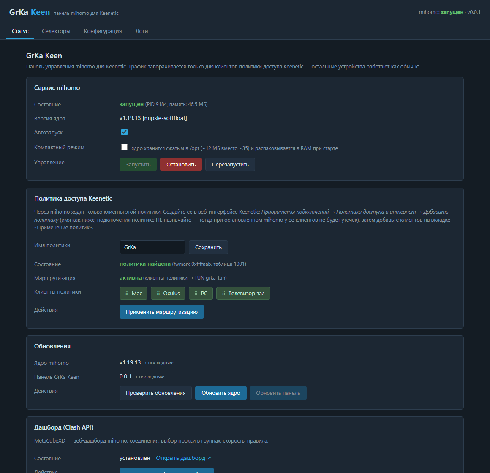
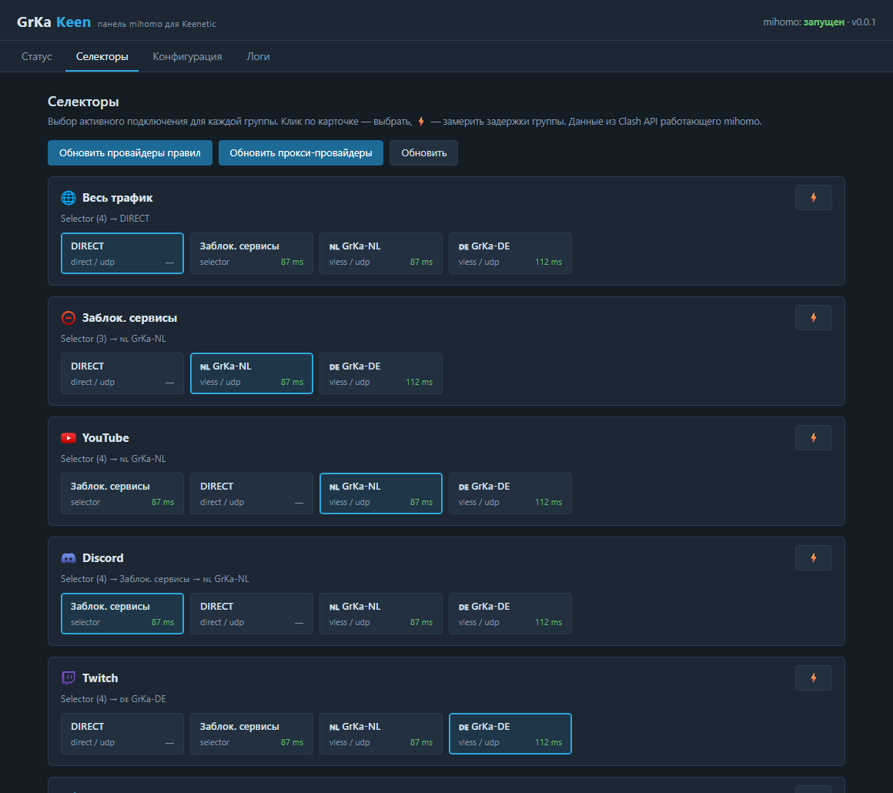
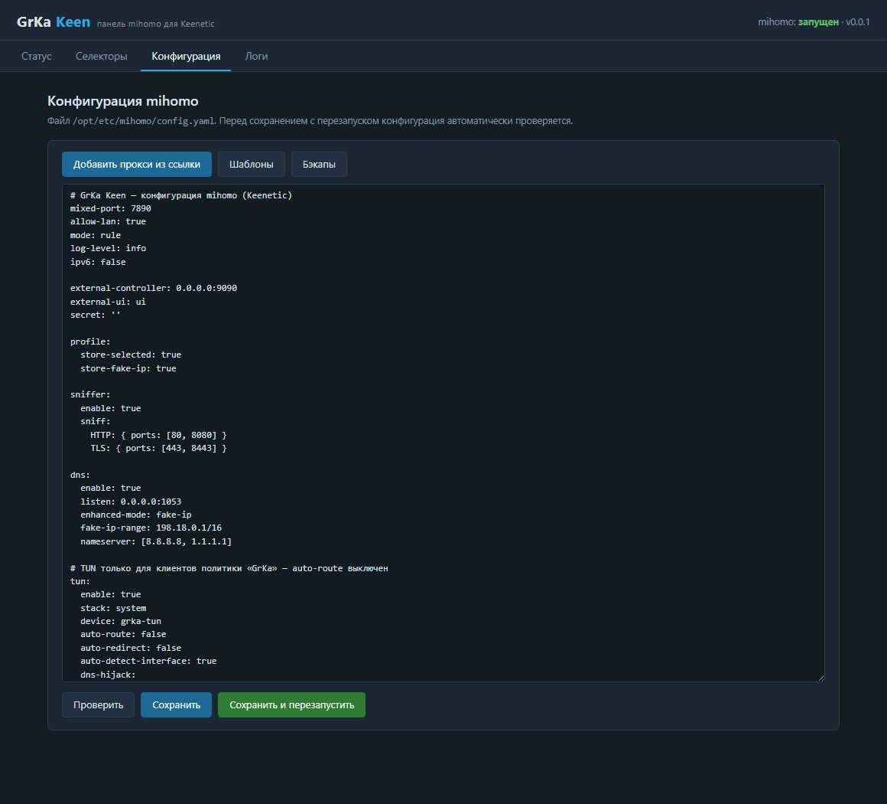
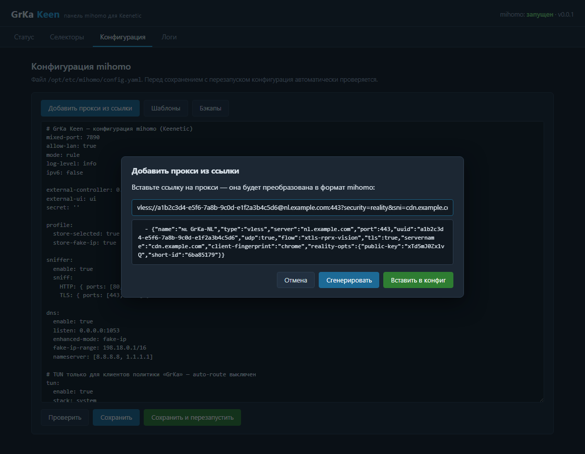
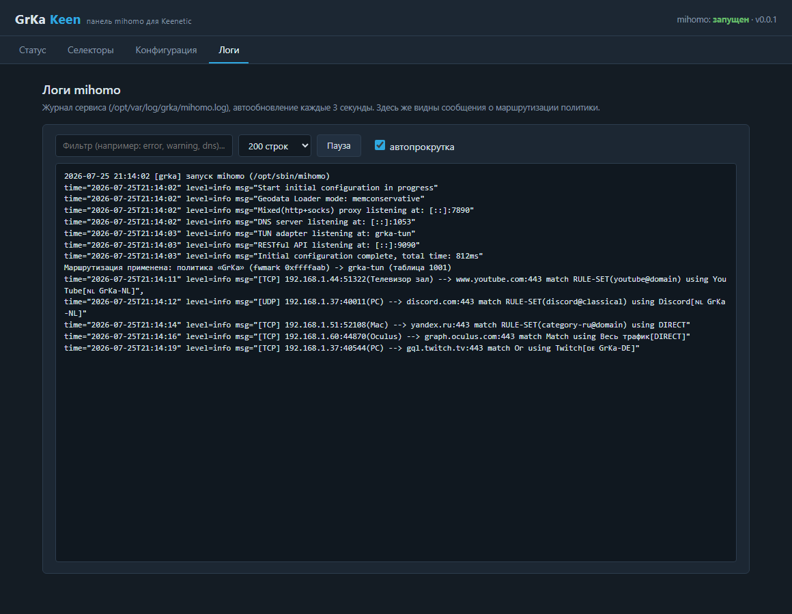

# GrKa Keen

Панель управления **mihomo** для роутеров **Keenetic** (поверх Entware). Отдельная вебморда на порту **1100** — как [XKeen-UI](https://github.com/zxc-rv/XKeen-UI), но с ядром mihomo и заворачиванием трафика **только для клиентов политики доступа Keenetic**.

Брат-близнец [GrKa OpenWRT](https://github.com/Soporif1c/GrKa-OpenWRT) — тот же функционал, но для Keenetic.

## Главная идея: политика доступа «GrKa»

Через mihomo ходят **только клиенты, добавленные в политику Keenetic** (по умолчанию с именем `GrKa`). Остальные устройства сети работают как обычно и вообще не видят прокси.

Как это устроено:

1. В веб-интерфейсе Keenetic создаётся политика доступа `GrKa` (*Приоритеты подключений → Политики доступа в интернет*). **Подключения политике не назначайте** — тогда при остановленном mihomo у её клиентов не будет доступа в интернет (режим резервирования, никаких утечек в обход прокси).
2. Клиенты добавляются в политику на вкладке *Применение политик* — так же, как вы привыкли делать для XKeen.
3. NDM (прошивка Keenetic) маркирует трафик клиентов политики своим fwmark — GrKa Keen узнаёт его через RCI (`show ip policy`) по имени политики.
4. Панель добавляет правило `ip rule fwmark <mark> → таблица 1001` с приоритетом 99 (раньше правил самих политик, у которых приоритеты 100–107) и маршрут `default dev grka-tun` в этой таблице — весь трафик клиентов политики уходит в TUN mihomo.
5. DNS-запросы клиентов политики (в том числе к самому роутеру) перенаправляются в DNS mihomo правилом iptables по той же марке; плюс включён сниффер mihomo — доменные правила работают в любом случае.
6. Хуки NDM (`/opt/etc/ndm/netfilter.d`, `/opt/etc/ndm/ifstatechanged.d`) автоматически переприменяют правила при перезагрузке файрвола и смене интерфейсов.

Дальше всё настраивается как в GrKa OpenWRT: **напрямую весь трафик или через прокси — одним переключателем**, а отдельные сервисы (YouTube, Discord, Twitch и т.д.) — каждый со своим выбором на вкладке «Селекторы».

## Возможности

- **Статус** — запуск/остановка/перезапуск mihomo, автозапуск, PID и потребление памяти
- **Политика Keenetic** — состояние политики (fwmark, маршрутизация), список её клиентов, смена имени политики, ручное переприменение маршрутизации
- **Селекторы** — выбор активного прокси в группах (через Clash API): клик по карточке — выбрать, ⚡ — замерить задержки, обновление rule/proxy-провайдеров. Главный переключатель **«Весь трафик» (напрямую/через прокси)** + у каждого сервиса свой выбор
- **Ядро** — установка и обновление mihomo с официального репозитория [MetaCubeX/mihomo](https://github.com/MetaCubeX/mihomo) (архитектура определяется автоматически)
- **Компактный режим** — ядро хранится в /opt сжатым (~12 МБ вместо ~35) и распаковывается в RAM при старте
- **Самообновление** — обновление панели с GitHub-релизов в один клик
- **Конфигурация** — редактор `/opt/etc/mihomo/config.yaml` с проверкой (`mihomo -t`) перед перезапуском
- **Шаблоны** — готовые конфигурации, включая «Сервисы и селекторы» (YouTube, Discord, Telegram, AI, CDN и др.)
- **Генератор прокси** — преобразование ссылок `vless://`, `vmess://`, `trojan://`, `ss://`, `hysteria2://`, `tuic://` в формат mihomo
- **Бэкапы** — автоматический бэкап конфига при каждом сохранении (последние 10), восстановление из панели
- **Логи** — просмотр журнала с автообновлением, фильтром и автопрокруткой
- **Дашборд** — установка [MetaCubeXD](https://github.com/MetaCubeX/metacubexd) в один клик

## Скриншоты

**Статус** — сервис, политика Keenetic с клиентами, обновления, дашборд:



**Селекторы** — «Весь трафик» (напрямую/прокси), выбор прокси для каждого сервиса, замер задержек:



**Конфигурация** — редактор config.yaml с проверкой, шаблонами, бэкапами и генератором прокси:



**Генератор прокси** — ссылка превращается в формат mihomo и вставляется в конфиг:



**Логи** — журнал mihomo и сообщения маршрутизации политики:



## Требования

- Keenetic с установленным [Entware](https://help.keenetic.com/hc/ru/articles/360021214160)
- Поддержка TUN: установите компонент системы **OpenVPN** (*Управление → Параметры системы → Обновления и компоненты*), он добавляет `/dev/net/tun`
- ~40 МБ свободного места в /opt для ядра mihomo (либо ~12 МБ в компактном режиме + ~35 МБ RAM)
- Зависимости ставятся установщиком автоматически: `lighttpd`, `lighttpd-mod-cgi`, `jq`, `curl`, `iptables`, `ip-full`

## Установка

```sh
sh -c "$(wget -qO- https://raw.githubusercontent.com/Soporif1c/GrKa-Keen/main/install.sh)"
```

или через curl:

```sh
sh -c "$(curl -fsSL https://raw.githubusercontent.com/Soporif1c/GrKa-Keen/main/install.sh)"
```

Установщик поставит зависимости, скачает последний релиз панели и ядро mihomo, создаст конфиг по умолчанию и запустит вебморду.

После установки откройте **http://<IP роутера>:1100** и:

1. В веб-интерфейсе Keenetic создайте политику доступа **GrKa** (подключения не назначайте) и добавьте в неё клиентов (*Применение политик*)
2. В панели: «Конфигурация» → «Добавить прокси из ссылки» → «Сохранить и перезапустить»
3. «Статус» → сервис запущен, политика найдена, маршрутизация активна
4. «Селекторы» → выбирайте, что пускать через прокси, а что напрямую

> Панель не имеет авторизации и предназначена для локальной сети. Не пробрасывайте порт 1100 в интернет.

## Обновление

- **Ядро mihomo**: Статус → «Проверить обновления» → «Обновить ядро»
- **Панель**: Статус → «Проверить обновления» → «Обновить панель»
- Либо повторный запуск установочной команды — она всегда ставит последний релиз (конфигурация не трогается)

## Как это устроено

```
/opt/share/grka/www/                       вебморда (index.html, app.js, style.css)
/opt/share/grka/www/cgi-bin/api            CGI-бэкенд (shell + jq)
/opt/share/grka/scripts/policy-route.sh    маршрутизация политики Keenetic -> TUN mihomo
/opt/share/grka/scripts/common.sh          общие функции (GitHub API, архитектура)
/opt/share/grka/scripts/core-update.sh     установка/обновление ядра mihomo
/opt/share/grka/scripts/self-update.sh     самообновление панели
/opt/share/grka/scripts/dashboard-install.sh  установка MetaCubeXD
/opt/share/grka/scripts/compact-toggle.sh  компактный режим хранения ядра
/opt/share/grka/templates/*.yaml           шаблоны конфигураций
/opt/etc/init.d/S97mihomo                  сервис mihomo
/opt/etc/init.d/S99grka-keen               сервис веб-панели (lighttpd)
/opt/etc/grka/lighttpd.conf                конфиг веб-сервера (порт панели)
/opt/etc/grka/grka.conf                    настройки (имя политики)
/opt/etc/ndm/netfilter.d/50-grka.sh        хук NDM: переприменение правил файрвола
/opt/etc/ndm/ifstatechanged.d/50-grka.sh   хук NDM: переприменение маршрутов
/opt/etc/mihomo/config.yaml                конфигурация (не трогается при обновлениях)
/opt/etc/mihomo/backups/                   бэкапы конфигурации
/opt/var/log/grka/mihomo.log               лог mihomo и маршрутизации
```

Сборка релизного архива: `./build.sh` → `grka-keen-<version>.tar.gz` (распаковывается в `/` роутера).

## Удаление

```sh
/opt/etc/init.d/S97mihomo stop; /opt/etc/init.d/S99grka-keen stop
sh /opt/share/grka/scripts/policy-route.sh clear
rm -rf /opt/share/grka /opt/etc/grka /opt/etc/init.d/S97mihomo /opt/etc/init.d/S99grka-keen \
  /opt/etc/ndm/netfilter.d/50-grka.sh /opt/etc/ndm/ifstatechanged.d/50-grka.sh \
  /opt/sbin/mihomo /opt/var/log/grka
# конфигурация: rm -rf /opt/etc/mihomo
```

## Лицензия

MIT
